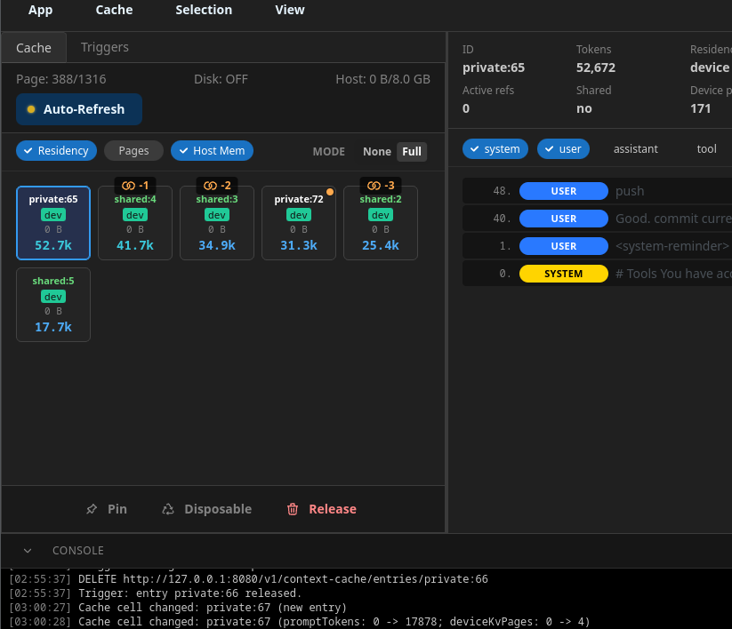

# KvSpy

KvSpy is a KV cache inspector that connects to a running inference engine and
lets you manage its context cache externally.



# Features

- Visualize KV cache state (entries, sizes, residency, retention, usage aggregates).
- Issue commands to manage the cache: pin (keep), mark disposable, release (evict).
- Inspect captured prompt content per entry; search across the cache for related cells.
- Delta sync: cheap polling that only transfers changed entries.
- Auto-command triggering by custom context markers — see
  [docs/trigger-markers.md](./docs/trigger-markers.md) (detection, delayed
  firing, fixed throw-away-session triggers, dry-run/test modes).

# Inference Engine API

KvSpy talks to an inference engine over plain HTTP + JSON. An engine must
support the API spec to be used with KvSpy — see
[docs/engine-api.md](./docs/engine-api.md) for the full specification
(endpoints, response schema, delta sync, retention steering, release).

# Project Navigation

Read [docs/navigation.md](./docs/navigation.md) — a quick map of the key files,
folders, and boot flow.

# Development

The project structure, architecture, and conventions follow the `GitUp` reference
project. It is a NeutralinoJs + Vite + React + TypeScript app; the app data lives under
`~/.KvSpy/`.

The build logic lives in `package.json` npm scripts; the files under `scripts/` are
thin convenience wrappers (Linux) that do different degrees of work.

## Scripts

```bash
npm install          # install dependencies
npm run dev          # Vite dev server (browser dev)
npm run dev:desktop  # run as a desktop window via the Neutralino binary (neu run)
npm run lint         # eslint over src/
```

Convenience wrappers (run from anywhere, they cd into the project):

```bash
scripts/build.sh          # web frontend only (tsc + Vite → dist/)
scripts/build_package.sh  # + package desktop binaries → dist/KvSpy/ (neu build)
scripts/install.sh        # install a Linux start-menu launcher (npm run install)
```

Notes:

- `neu build` also runs the frontend build and writes binaries into `dist/KvSpy/`, so
  Vite's output dir is not emptied (see `vite.config.ts`); the two share `dist/`.
- `scripts/install.sh` writes `~/.local/share/applications/com.app.kvspy.desktop` pointing
  at `dist/KvSpy/KvSpy-<platform>`; re-run it after a rebuild or move.
- `npm run dev` runs the app in a plain browser, where the Native bridge is absent, so
  `~/.KvSpy` paths are never initialized. `Connect` then fails at a `Log.write` call and
  no cache data loads — features that depend on engine data (cell selection, prompt
  content, ...) can't be exercised this way. Use `npm run dev:desktop` (`neu run`) for a
  data-backed test.

# License

Apache License 2.0 — see [LICENSE](./LICENSE).
